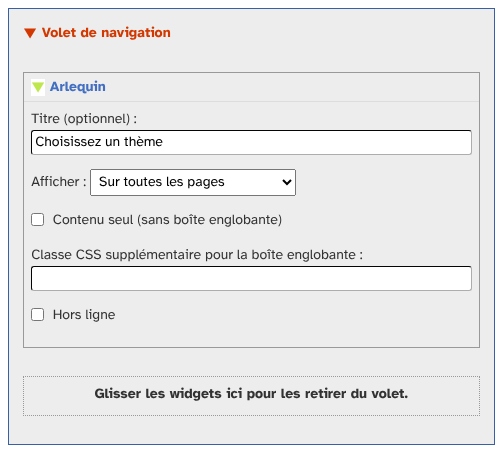
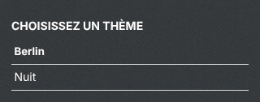
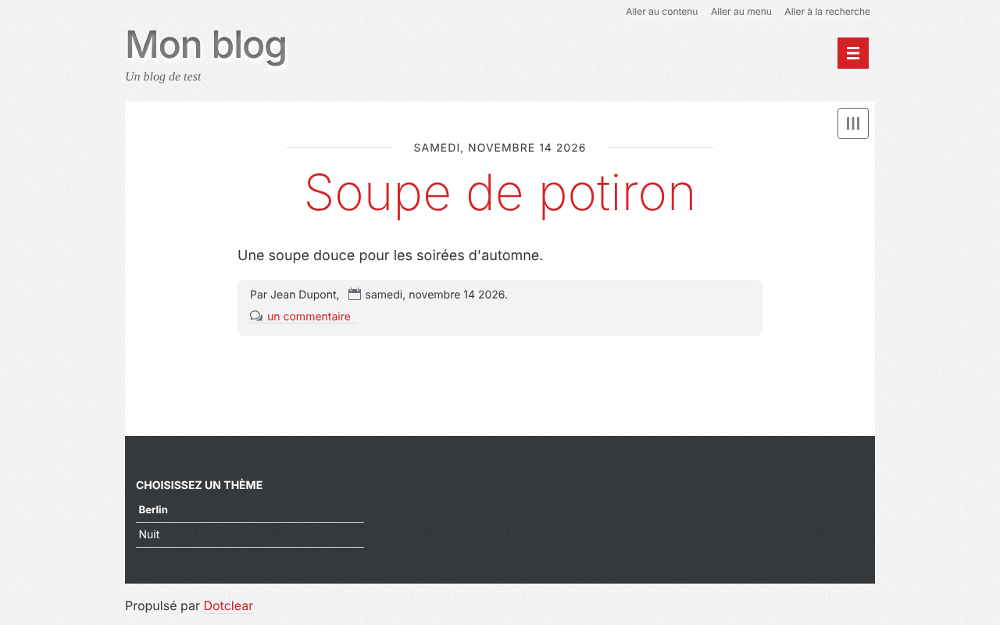
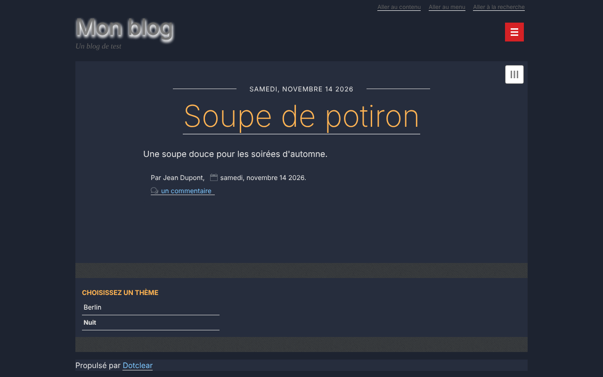
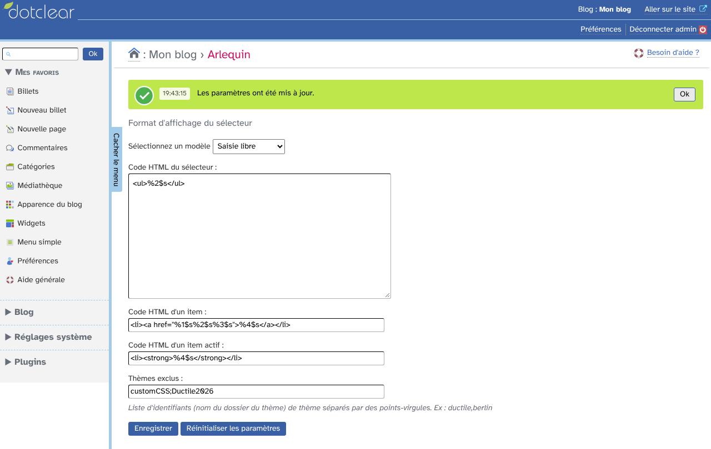
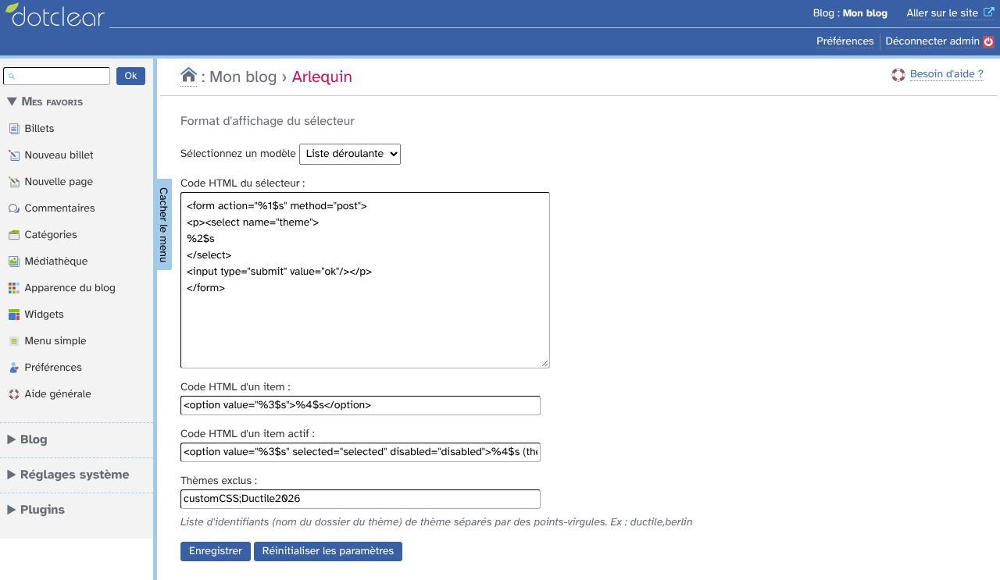
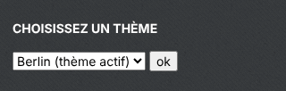

# Arlequin : guide d'utilisation

Arlequin permet à vos visiteurs de choisir eux-mêmes le thème d'affichage de votre blog, parmi les thèmes que vous aurez retenus. Le choix est mémorisé dans un cookie du navigateur : il suit le visiteur de page en page et d'une visite à l'autre, sans rien changer pour les autres visiteurs.

## Sommaire

* [Avant de commencer](#avant-de-commencer)
* [Afficher le sélecteur de thème](#afficher-le-sélecteur-de-thème)
* [Ce que voient les visiteurs](#ce-que-voient-les-visiteurs)
* [Choisir la forme du sélecteur](#choisir-la-forme-du-sélecteur)
* [Exclure des thèmes](#exclure-des-thèmes)
* [Réinitialiser les réglages](#réinitialiser-les-réglages)

## Avant de commencer

Le plugin nécessite les droits d'administration du contenu du blog. Sa page de réglages se trouve dans le menu **Blog** de l'administration, sous le nom **Arlequin**, et peut aussi être ajoutée au tableau de bord.

Les thèmes proposés aux visiteurs sont les thèmes installés et activés. Dans ce guide, le blog de test « Mon blog » propose deux thèmes : Berlin (le thème du blog) et Nuit, un thème sombre.

## Afficher le sélecteur de thème

Le sélecteur est un widget : rien ne s'affiche tant que vous ne l'avez pas ajouté à un volet.

1. Ouvrez la page **Widgets** de l'administration ;
2. glissez le widget **Arlequin** (« Sélecteur de thème ») dans le volet de votre choix ;
3. cliquez sur le nom du widget pour régler ses options ;
4. cliquez sur **Mettre à jour les volets**.

Options du widget :

* **Titre** : texte affiché au-dessus du sélecteur (« Choisissez un thème » par défaut) ;
* **Afficher** : sur toutes les pages ou seulement sur la page d'accueil ;
* **Contenu seul** : supprime la boîte qui entoure le widget ;
* **Classe CSS supplémentaire** pour cette boîte ;
* **Hors ligne** : cache le widget sans le supprimer.

## Ce que voient les visiteurs

Par défaut, le widget affiche la liste des thèmes sous forme de liens. Le thème en cours est en gras, sans lien.

Un clic sur un autre thème change l'apparence du blog entier.

| Thème Berlin | Thème Nuit |
|---|---|
|  |  |

Le choix est conservé pendant un an dans un cookie. Un visiteur qui n'a rien choisi voit le thème normal du blog.

## Choisir la forme du sélecteur

La page **Arlequin** règle l'aspect du sélecteur.

Le menu **Sélectionnez un modèle** propose :

* **Liste à puces** : une liste de liens (modèle par défaut) ;
* **Liste déroulante** : un menu déroulant avec un bouton « ok » ;
* **Saisie libre** : vous écrivez vous-même le HTML.

Choisir un modèle remplit les trois champs de code ci-dessous, que vous pouvez ensuite retoucher. Cliquez sur **Enregistrer** pour appliquer.

Avec la liste déroulante, le visiteur choisit son thème puis clique sur **ok**. Le thème actif y est marqué « (thème actif) ».

**Écrire son propre code.** Trois champs :

* **Code HTML du sélecteur** : l'enveloppe de l'ensemble ;
* **Code HTML d'un item** : un thème qui peut être choisi ;
* **Code HTML d'un item actif** : le thème en cours.

Ils contiennent des variables de la forme `%n$s`. Dans le code du sélecteur :

| Variable | Signification |
|---|---|
| `%1$s` | URL de la page courante |
| `%2$s` | le code HTML des items |

Dans le code d'un item :

| Variable | Signification |
|---|---|
| `%1$s` | URL de la page courante |
| `%2$s` | suffixe qui transmet le thème dans l'URL, par exemple `?theme=` |
| `%3$s` | identifiant du thème, à n'utiliser que dans une URL |
| `%4$s` | nom du thème |
| `%5$s` | description du thème |
| `%6$s` | identifiant du thème |

Par exemple, le modèle « Liste à puces » est composé de `<ul>%2$s</ul>` pour le sélecteur et de `<li><a href="%1$s%2$s%3$s">%4$s</a></li>` pour un item.

## Exclure des thèmes

Le champ **Thèmes exclus** liste les thèmes que les visiteurs ne doivent pas pouvoir choisir : identifiants (noms des dossiers des thèmes) séparés par des points-virgules, par exemple `customCSS;Ductile2026`.

Par défaut, `customCSS` est exclu. Un thème exclu n'apparaît pas dans le sélecteur, et un visiteur qui l'aurait mémorisé retrouve le thème du blog.

## Réinitialiser les réglages

Le bouton **Réinitialiser les paramètres** remet le modèle par défaut et la liste d'exclusion initiale. Le champ de code est alors vidé de vos modifications : notez-les avant si vous voulez les garder.
